# 🌐 Small Business Network — Final Project

> A Cisco Packet Tracer implementation of a secure, segmented small-business network using VLANs, router-on-a-stick, DHCP, static server addressing, ISP routing, NAT/PAT, and an extended ACL.

## 📌 Project Overview

This final project simulates a small-business network in which users, guests, and servers are placed in separate VLANs. The network is routed by **R1-EDGE**, which provides inter-VLAN communication, DHCP services, ISP access through NAT/PAT, and Guest network isolation through an extended access control list.

The project demonstrates practical CCNA-level implementation and verification of Layer 2 segmentation, Layer 3 routing, IP services, NAT, and network security in one integrated Packet Tracer topology.

## 🎯 Project Objectives

- Create separate VLANs for Admin, Staff, Guest, and Server devices.
- Configure switch access ports and an 802.1Q trunk to the edge router.
- Enable inter-VLAN routing using router-on-a-stick.
- Assign IP configuration automatically to end-user PCs with DHCP.
- Configure a server with a static IP address.
- Establish routing between the internal network and the simulated ISP.
- Translate private addresses to a public address using NAT/PAT.
- Prevent Guest users from accessing Admin, Staff, and Server networks.
- Validate connectivity, routing, NAT translations, interfaces, and ACL behavior.

## 🛠 Technologies Used

| Technology | Purpose in this project |
|---|---|
| Cisco Packet Tracer | Network simulation and validation |
| VLANs | Department and security segmentation |
| IEEE 802.1Q trunking | Carries multiple VLANs from switch to router |
| Router-on-a-stick | Inter-VLAN routing with router subinterfaces |
| DHCP | Automatic client IP addressing |
| Static IP addressing | Server configuration |
| Static / return routing | Internal-to-ISP and return-path reachability |
| NAT/PAT | Private-to-public address translation |
| Extended ACL | Guest network access control |
| ICMP ping | Connectivity testing and validation |

## 🧩 Network Topology

The access switch connects the Admin PC, Staff PCs, Guest PC, and Server. A single 802.1Q trunk carries all VLANs between the switch and R1-EDGE. R1-EDGE routes internal traffic and connects to the ISP router, which in turn connects to the ISP test PC.

```text
Admin PC ─┐
Staff PC1├── Access Switch ── 802.1Q Trunk ── R1-EDGE ── ISP Router ── ISP PC
Staff PC2├──                         │
Guest PC ┤                         NAT/PAT
Server ──┘
```

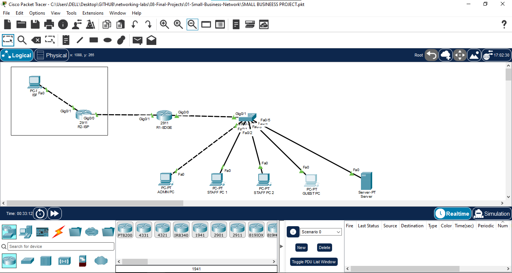

## 🗂 VLAN and Addressing Plan

| VLAN | Department / Device Group | IPv4 Network | Default Gateway | Address Assignment |
|---:|---|---|---|---|
| 10 | Admin | `192.168.10.0/24` | `192.168.10.1` | DHCP |
| 20 | Staff | `192.168.20.0/24` | `192.168.20.1` | DHCP |
| 30 | Guest | `192.168.30.0/24` | `192.168.30.1` | DHCP + ACL restrictions |
| 40 | Server | `192.168.40.0/24` | `192.168.40.1` | Static IP |

The external test host uses `198.51.100.10`. NAT validation confirms that R1-EDGE uses `203.0.113.2` as the inside-global address for translated traffic.

## ⚙️ Implementation Details

### 1. VLAN configuration and switch port assignment

Four VLANs were created to separate Admin, Staff, Guest, and Server traffic. End-device switch ports were configured as access ports in their respective VLANs. The uplink to R1-EDGE was configured as an 802.1Q trunk to transport all required VLANs.

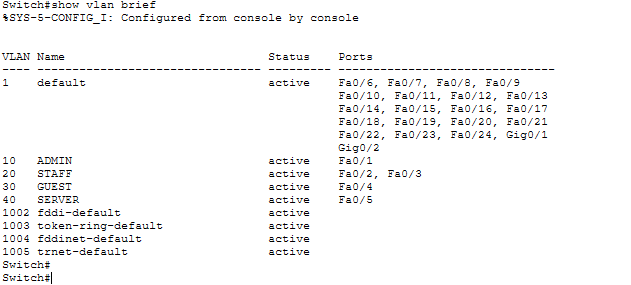

### 2. Inter-VLAN routing — router-on-a-stick

R1-EDGE uses subinterfaces on `GigabitEthernet0/0` to provide the default gateway for each VLAN:

| R1-EDGE subinterface | VLAN | Gateway address |
|---|---:|---|
| `GigabitEthernet0/0.10` | 10 | `192.168.10.1` |
| `GigabitEthernet0/0.20` | 20 | `192.168.20.1` |
| `GigabitEthernet0/0.30` | 30 | `192.168.30.1` |
| `GigabitEthernet0/0.40` | 40 | `192.168.40.1` |

Each subinterface is associated with its VLAN through `encapsulation dot1Q`, allowing one physical router interface to route traffic for multiple logical networks.

### 3. DHCP services

DHCP pools provide IP address, subnet mask, and default gateway details for the Admin, Staff, and Guest VLANs. The following results confirm that all required client devices received an address dynamically.

| Device | Verification |
|---|---|
| Admin PC | DHCP lease obtained |
| Staff PC 1 | DHCP lease obtained |
| Staff PC 2 | DHCP lease obtained |
| Guest PC | DHCP lease obtained |

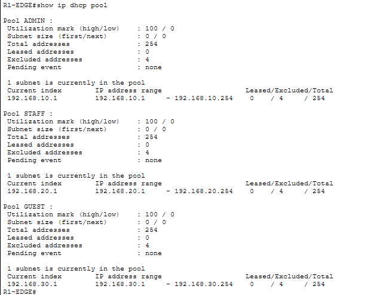

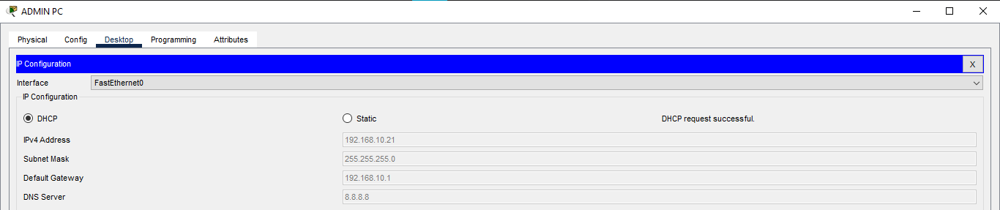


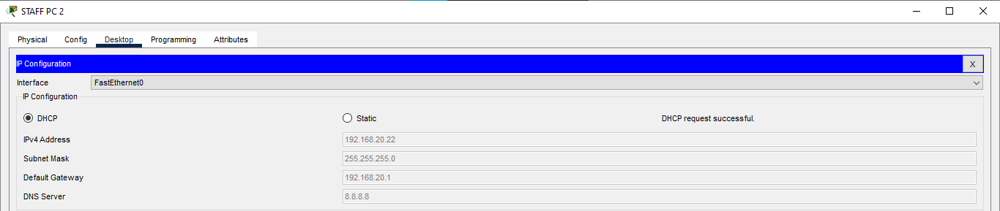


### 4. Server configuration

The server is placed in VLAN 40 and uses a static IPv4 configuration. Static addressing keeps the server consistently reachable by permitted internal clients and simplifies service-host identification.

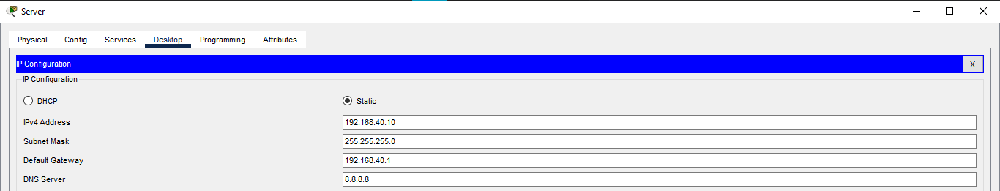

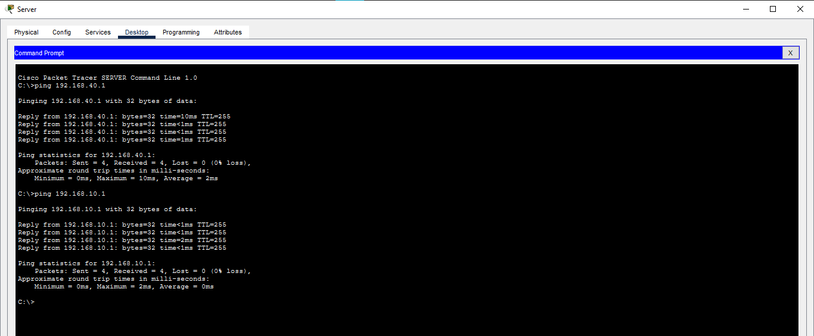

### 5. ISP connectivity and return routing

R1-EDGE has an outside interface connected to the ISP router. The ISP router includes return routes for the private VLAN subnets, providing a return path for traffic sent from the LAN toward the ISP test PC.

This routing design ensures that connectivity succeeds in both directions before and alongside NAT/PAT verification.

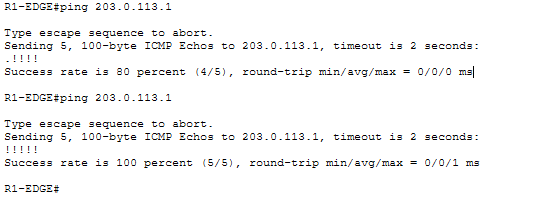

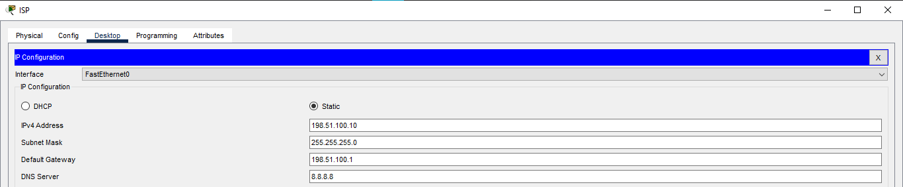

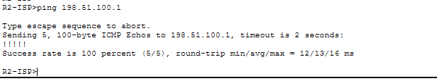

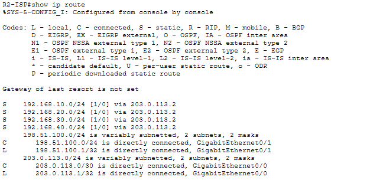

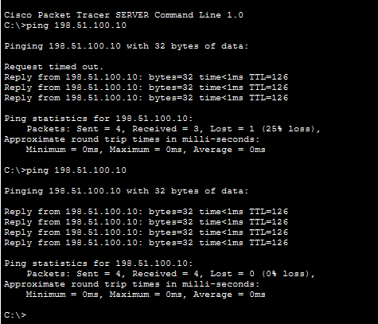

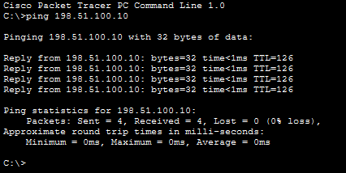

### 6. NAT/PAT configuration

R1-EDGE is configured with inside and outside NAT roles. Internal VLAN traffic is matched for translation and overloaded to the public-facing address `203.0.113.2` when it reaches the ISP side.

The captured NAT output confirms dynamic ICMP translations from `192.168.40.10` to `203.0.113.2` when communicating with `198.51.100.10`.

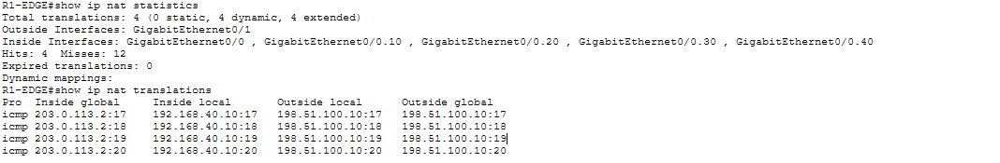

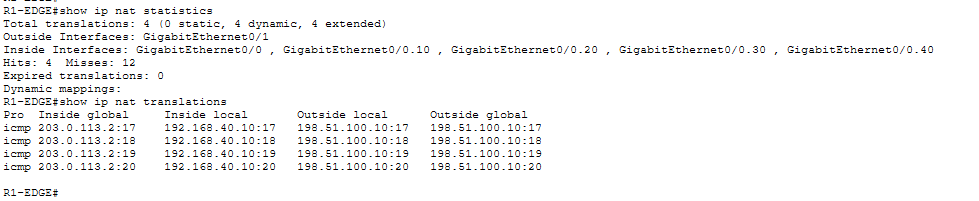

### 7. Guest network security — extended ACL

The extended ACL named `GUEST-RESTRICTION` is used to isolate the Guest VLAN from protected internal networks.

| ACL sequence | Source | Destination | Action |
|---:|---|---|---|
| 10 | `192.168.30.0/24` | `192.168.10.0/24` (Admin) | Deny |
| 20 | `192.168.30.0/24` | `192.168.20.0/24` (Staff) | Deny |
| 30 | `192.168.30.0/24` | `192.168.40.0/24` (Server) | Deny |
| 40 | `192.168.30.0/24` | Any other destination | Permit |

This policy allows Guest users to access approved external destinations while preventing lateral access to Admin, Staff, and Server resources.

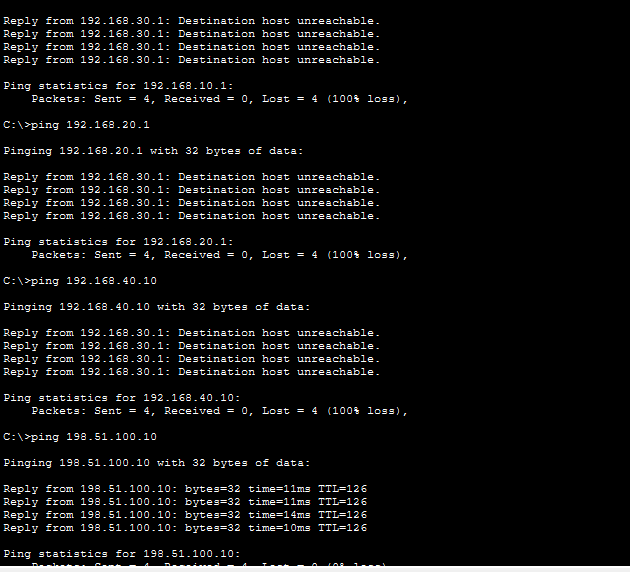

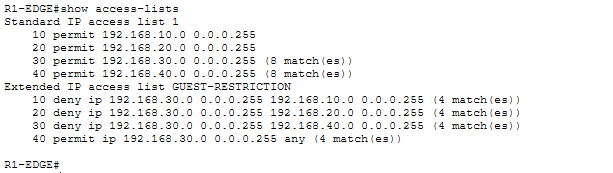

## ✅ Final Verification

| Test | Expected result | Status |
|---|---|---|
| VLAN creation and port assignment | VLANs 10, 20, 30, and 40 are present | Verified |
| DHCP address assignment | Client PCs receive correct VLAN addressing | Verified |
| Server static addressing | Server retains configured address and gateway | Verified |
| Inter-VLAN routing | Permitted VLAN traffic reaches its destination | Verified |
| Router-to-ISP link | Edge router reaches the ISP side | Verified |
| Return routing | ISP router knows paths to internal networks | Verified |
| NAT/PAT | Internal traffic translates to `203.0.113.2` | Verified |
| Guest ACL | Guest-to-Admin/Staff/Server traffic is denied | Verified |
| Final interfaces and routes | R1-EDGE operational state matches the design | Verified |

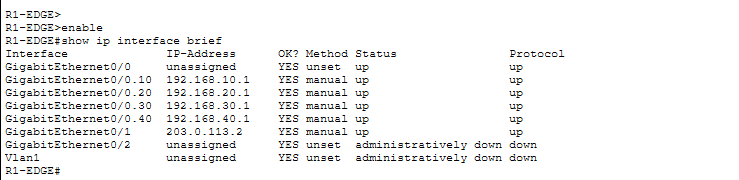

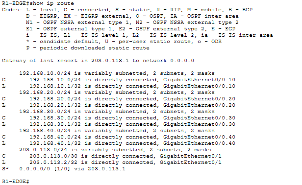

## 📸 Project Evidence

| No. | Screenshot / Evidence |
|---:|---|
| 01 | `01-Small-Business-Network.pkt` — Packet Tracer project file |
| 02 | `02-vlan-configuration` — VLAN setup |
| 03 | `03-network-topology` — complete topology |
| 04 | `04-dhcp-pools` — DHCP pool configuration |
| 05–08 | DHCP leases for Admin, Staff 1, Staff 2, and Guest PCs |
| 09–10 | Server static IP and connectivity proof |
| 11–16 | ISP link, ISP PC, return routes, and end-to-end pings |
| 17 | NAT translation table |
| 18 | Guest ACL test |
| 19–22 | Final interface, route, NAT, and ACL verification |

## 📁 Project Files

Keep the Packet Tracer file, README, and all screenshots together in the same project folder. This README intentionally uses direct image links (for example, `03-network-topology.png`) rather than a `screenshots/` subfolder.

```text
Small-Business-Network/
│
├── 01-Small-Business-Network.pkt
├── 02-vlan-configuration.png
├── 03-network-topology.png
├── 04-dhcp-pools.png
├── 05-admin-pc-dhcp.png
├── 06-staff-pc1-dhcp.png
├── 07-staff-pc2-dhcp.png
├── 08-guest-pc-dhcp.png
├── 09-server-static-ip.png
├── 10-server-connectivity-test.png
├── 11-router-link-ping.png
├── 12-isp-pc-static-ip.png
├── 13-isp-pc-connectivity.png
├── 14-r2-return-routes.png
├── 15-server-to-isp-ping.png
├── 16-admin-to-isp-ping.png
├── 17-nat-translations.png
├── 18-guest-acl-test.png
├── 19-final-interface-status.png
├── 20-final-routing-table.png
├── 21-final-nat-statistics.png
├── 22-final-acl-verification.png
└── README.md
```

> **Important:** Replace `.png` in the README links if your real screenshot extension is `.jpg`, `.jpeg`, or another format. The filename, capitalization, and extension must exactly match the uploaded GitHub files for images to display.

## 🚀 How to Run the Project

1. Download or clone this project folder.
2. Open `01-Small-Business-Network.pkt` with Cisco Packet Tracer.
3. Wait for all devices and interfaces to initialize.
4. Use the end devices and router CLI to repeat the connectivity, NAT, and ACL verification tests.
5. Open this `README.md` on GitHub to view the documentation and evidence images.

## 📚 Skills Demonstrated

- IPv4 subnetting and addressing design
- VLAN segmentation and access-port configuration
- 802.1Q trunking
- Router-on-a-stick inter-VLAN routing
- DHCP configuration and client validation
- Static server addressing
- Static routing and ISP return routing
- NAT overload / PAT verification
- Extended ACL design and enforcement
- Cisco IOS verification and troubleshooting commands
- Technical documentation of an end-to-end network project

## 🏁 Conclusion

This project brings together switching, routing, IP services, NAT, and ACL security in one complete Packet Tracer environment. The final validation demonstrates successful addressing, controlled inter-VLAN connectivity, ISP reachability through NAT/PAT, and protection of internal resources from the Guest VLAN.
