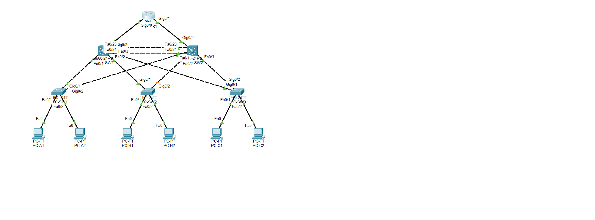

# Enterprise Switching Network (Cisco Packet Tracer)
 
A multi-layer campus switching lab built in Cisco Packet Tracer 9.0.1. The design uses a redundant Layer 3 core, three access switches, departmental VLANs, first-hop gateway redundancy, loop prevention, automated host addressing and routed edge connectivity. The lab also documents operational caveats and tests that have not yet been performed.
 
All results below come from the live `02-Enterprise-Switching.pkt` project and the screenshots in this folder. Anything that was not tested is marked **Not tested**.
 
---
 
## Project Overview
 
The network follows a two-tier campus design. CORE-SW1 and CORE-SW2 provide Layer 3 switching and redundant HSRP gateways. ACC-SW1, ACC-SW2 and ACC-SW3 connect two client PCs each and uplink to both cores. Port-channel1 joins the cores, while EDGE-R1 has one routed point-to-point connection to each core.

The redundant physical paths do not all forward traffic at the same time: Spanning Tree blocks ACC-SW1 Gi0/2 in the captured state to prevent a Layer 2 loop. The routed core-to-router links provide an upstream path to EDGE-R1; the router has no separate upstream connection in this lab.
 
### Objectives
 
- Segment users into VLANs 10 (Sales), 20 (HR), 30 (IT) and 99 (Management)
- Trunk all switch-to-switch links with native VLAN 99 and an allowed-VLAN list
- Bundle the two core-to-core links into an LACP Port-channel
- Make CORE-SW1 the STP root and CORE-SW2 the backup root
- Provide redundant default gateways with HSRP
- Provide DHCP for each VLAN and secure the PC-facing access ports
- Connect the cores to an edge router with routed links and default routes

The objectives describe the intended design. Results below distinguish configuration evidence from behavior that was not tested.
 
## Technologies Used
 
- Cisco Packet Tracer 9.0.1
- Cisco 3560-24PS Layer 3 switches (core), 2960-24TT switches (access), 2911 router, PC-PT hosts
- VLANs and 802.1Q trunking (native VLAN 99)
- LACP EtherChannel (Port-channel1)
- Rapid PVST+ (RSTP)
- HSRP version 2 with preempt
- Inter-VLAN routing with SVIs on the cores
- IOS DHCP pools on the cores
- Port security with sticky MAC learning
- Static routing
---
 
## Network Topology
 

 
| Device | Model | Role |
|---|---|---|
| EDGE-R1 | 2911 | Edge router |
| CORE-SW1 | 3560-24PS | Core, STP root, HSRP active |
| CORE-SW2 | 3560-24PS | Core, STP backup root, HSRP standby |
| ACC-SW1 | 2960-24TT | Access for PC-A1, PC-A2 (VLAN 10) |
| ACC-SW2 | 2960-24TT | Access for PC-B1, PC-B2 (VLAN 20) |
| ACC-SW3 | 2960-24TT | Access for PC-C1, PC-C2 (VLAN 30) |
 
Links:
 
- CORE-SW1 and CORE-SW2: Fa0/23 and Fa0/24 on each core, bundled as Port-channel1
- Each core Fa0/1, Fa0/2 and Fa0/3 to the Gi0/1 (CORE-SW1) or Gi0/2 (CORE-SW2) uplink of ACC-SW1, ACC-SW2 and ACC-SW3
- EDGE-R1 Gi0/0 to CORE-SW1 Gi0/2, and EDGE-R1 Gi0/1 to CORE-SW2 Gi0/2
- Each PC to Fa0/1 or Fa0/2 of its access switch

The access-switch uplinks are physically redundant. STP determines which links forward for each VLAN; in the captured evidence, ACC-SW1 Gi0/2 is blocked while Gi0/1 forwards. The ACC-SW2 and ACC-SW3 trunk forwarding details were not captured, so their active and blocked paths are not described here.

---
 
## VLAN and IP Plan
 
| VLAN | Name | Subnet | HSRP gateway | CORE-SW1 SVI | CORE-SW2 SVI |
|---|---|---|---|---|---|
| 10 | Sales | 192.168.10.0/24 | 192.168.10.1 | 192.168.10.2 | 192.168.10.3 |
| 20 | HR | 192.168.20.0/24 | 192.168.20.1 | 192.168.20.2 | 192.168.20.3 |
| 30 | IT | 192.168.30.0/24 | 192.168.30.1 | 192.168.30.2 | 192.168.30.3 |
| 99 | Management | none | none | none | none |
 
VLAN 99 exists on the switches and is configured as the native VLAN on the documented trunks. It has no SVI and no member access ports in the captured configuration. Therefore, VLAN 99 does not provide an in-band management address for these switches. The VLAN ID is reserved in the design but management reachability has not been implemented.
 
Routed links:
 
| Link | Subnet | EDGE-R1 | Core |
|---|---|---|---|
| EDGE-R1 Gi0/0 to CORE-SW1 Gi0/2 | 10.0.0.0/30 | 10.0.0.1 | 10.0.0.2 |
| EDGE-R1 Gi0/1 to CORE-SW2 Gi0/2 | 10.0.0.4/30 | 10.0.0.5 | 10.0.0.6 |
 
PC addresses are assigned dynamically by DHCP, so a lease is a snapshot rather than a permanent host assignment. Addresses shown below are the values recorded at capture time:
 
| PC | VLAN | Address |
|---|---|---|
| PC-A1 | 10 | 192.168.10.128 |
| PC-A2 | 10 | 192.168.10.11 |
| PC-B1 | 20 | 192.168.20.10 |
| PC-B2 | 20 | 192.168.20.11 |
| PC-C1 | 30 | 192.168.30.10 |
| PC-C2 | 30 | 192.168.30.11 |
 
---
 
## Implementation
 
### 1. VLANs
 
Four VLANs provide separate broadcast domains for Sales, HR, IT and the reserved Management VLAN. VLANs 10, 20, 30 and 99 are present on all five switches. The three user VLANs have SVIs on both core switches; VLAN 99 currently has no SVI.
 

 
### 2. Access Port Assignments
 
Fa0/1 and Fa0/2 are access ports in VLAN 10 on ACC-SW1, VLAN 20 on ACC-SW2 and VLAN 30 on ACC-SW3.
 

 
### 3. Trunking
 
The documented switch-to-switch trunks use 802.1Q, native VLAN 99, and an allowed VLAN list of 10, 20, 30 and 99. This carries the user VLANs and the reserved native VLAN over shared physical uplinks.

In the captured STP state, ACC-SW1 Gi0/1 forwards and ACC-SW1 Gi0/2 is the redundant uplink in a non-forwarding state. The second link remains physically connected; STP blocks it to prevent a loop. Trunk details for ACC-SW2 and ACC-SW3 were not captured, so their allowed VLANs and forwarding states remain unverified.
 

 
### 4. Spanning Tree
 
Rapid PVST+ maintains a separate spanning-tree instance per VLAN. CORE-SW1 is the root bridge for VLANs 10, 20, 30 and 99, using priority 4096 plus the VLAN ID. CORE-SW2 has priority 8192 and is positioned as the backup root. In the captured state, CORE-SW2 reaches the root through Port-channel1.

STP prevents the redundant core/access paths from creating forwarding loops. As a result, a connected uplink may show as blocked for a VLAN while remaining available as an alternate path if the active path changes.
 

 
### 5. EtherChannel
 
Port-channel1 combines two physical FastEthernet links between the core switches using LACP. Both Fa0/23 and Fa0/24 are reported as bundled (P) on each core in the captured EtherChannel summaries. The port-channel is configured as a trunk, so the allowed VLANs can cross the inter-core connection.

This verifies the bundle membership at capture time. Link failure and recovery behavior were not separately tested.
 

 
### 6. HSRP
 
HSRP version 2 provides a shared default gateway address for each user VLAN. CORE-SW1 has priority 110 and is Active; CORE-SW2 has priority 100 and is Standby for groups 10, 20 and 30. Preempt is configured so the higher-priority core can resume the Active role after recovery.

The `show standby brief` output covers all three groups, so one screenshot per core is used for all three VLANs. The captured role state is verified; failover after shutting down a core or SVI was not tested.
 

 
### 7. Routed Uplinks and Routing
 
EDGE-R1 Gi0/0 and Gi0/1 connect to routed Gi0/2 interfaces on the two cores. The `/30` point-to-point subnets keep each router-to-core link in its own small network. Both links are reported up, and the cores have default routes pointing to EDGE-R1. EDGE-R1 has static return routes for `192.168.0.0/16` through both core addresses.

EDGE-R1 has no default route because the topology has no additional upstream device or Internet link. The lab therefore demonstrates routing to the edge router and return routing toward the campus, rather than Internet access.
 

 
### 8. DHCP
 
The core switches provide DHCP pools named SALES, HR and IT for the three client VLANs. Each pool supplies the subnet settings and the corresponding HSRP virtual address as the default gateway. The captured lease table shows bindings for all six PCs. Because the pool can allocate a different address later, the lease table and PC addresses in this README describe the capture-time state.
 

 
### 9. PC Configuration
 

 
### 10. Port Security
 
The client-facing Fa0/1 and Fa0/2 ports on each access switch use sticky MAC learning, with a maximum of one secure address and violation mode `shutdown`. At capture time each client port showed one secure MAC and zero violations.

This confirms the configured policy and current learned addresses. A deliberate unauthorized-device test was not run, so the shutdown response to a violation is configured but not behaviorally verified.
 

 
---
 
## Verification Results
 
The table separates observed configuration and successful checks from behavior that remains untested or incomplete. “Pass” refers to the captured command output or ping result at that point in the lab; it does not imply every failure mode has been tested.

| Test | Result |
|---|---|
| VLANs 10, 20, 30, 99 present on all switches | Pass (03, 03b, 04 series) |
| Access ports in correct VLANs | Pass (04 series) |
| Trunks with native VLAN 99, VLANs 10/20/30/99 allowed | Pass on both cores and ACC-SW1; ACC-SW2 and ACC-SW3 not captured |
| CORE-SW1 STP root for VLANs 10, 20, 30, 99 | Pass (06, 06b) |
| Port-channel1 LACP, both members bundled | Pass (07, 07b, 08) |
| HSRP: CORE-SW1 Active, CORE-SW2 Standby, groups 10/20/30 | Pass (09, 09b) |
| HSRP failover when CORE-SW1 fails | Not tested |
| EDGE-R1 Gi0/0 and Gi0/1 up with IPs | Pass (12) |
| Core routed links and default routes | Pass (13, 14 series) |
| DHCP leases for all six PCs | Pass (15, 16 series) |
| Port security: 1 of 1 secure MAC, 0 violations | Pass (17 series) |
| Port security violation behaviour | Not tested |
| PC to its HSRP gateway, second run | Pass, 4/4 for all six PCs |
| PC to EDGE-R1 10.0.0.1, first run | Partial, 1 packet lost per PC (PC-A1 lost 2) |
| PC to EDGE-R1 10.0.0.1, second run | 5 of 6 PCs 4/4; PC-A1 3/4 (shown in 18); a third PC-A1 run was 4/4 |
| Cross-VLAN PC to PC pings | Not re-run for this evidence set |
 
The gateway tests succeeded on their second run, but reachability to EDGE-R1 was less consistent. The first-ping series lost packets from each PC (PC-A1 lost two); on the second run five PCs reached `10.0.0.1` with 4/4 replies while PC-A1 received 3/4, and a later PC-A1 run received 4/4. The cause has not been identified, so treat PC-to-router connectivity as intermittently successful rather than fully resolved.
 

 
### Final Interface Status
 

 
### Final Topology
 

 
---
 
## Known Limitations
 
- **Management:** VLAN 99 is present as a native VLAN but has no SVI or access-port members, so switch management IP reachability is not configured.
- **Redundant uplinks:** ACC-SW1 Gi0/2 is connected but STP-blocked in the captured state. ACC-SW2 and ACC-SW3 trunk forwarding details were not captured.
- **Unused interfaces:** Gi0/1 on both cores is down and unused. EDGE-R1 Gi0/2 and Vlan1 are administratively down. The router has no default route or upstream link.
- **Access-port hardening:** Unused access ports Fa0/3–Fa0/24 remain in VLAN 1 and do not have port security configured.
- **Device identity:** IOS hostnames remain at their default values, which can make CLI sessions harder to distinguish.
- **Dynamic addressing:** DHCP lease addresses changed between testing and captures; listed PC addresses are not guaranteed to persist.
- **Unresolved connectivity:** PC-to-EDGE-R1 ping results varied between runs. The packet loss cause remains unknown.
- **Not tested:** HSRP failover, EtherChannel member failure/recovery, port-security violation handling and cross-VLAN host-to-host pings were not tested for this evidence set.
---
 
## Project Evidence
 
Screenshots are stored alongside this README. They show the topology, switch and router command output, client addressing, and connectivity checks. The port-labeled topology image is included as supplemental visual evidence; configuration claims should be read together with the matching CLI screenshots.
 
`01-network-topology.png`, `03-vlan-configuration.png`, `03b-vlan-configuration-core-sw2.png`, `04-access-port-assignments.png`, `04b-access-port-assignments-acc-sw2.png`, `04c-access-port-assignments-acc-sw3.png`, `05-trunk-configuration.png`, `05b-trunk-configuration-core-sw2.png`, `05c-trunk-configuration-acc-sw1.png`, `06-spanning-tree-root.png`, `06b-spanning-tree-root-vlan30-99.png`, `06c-spanning-tree-core-sw2-vlan10-99.png`, `07-etherchannel-summary.png`, `07b-etherchannel-summary-core-sw2.png`, `08-core-to-core-trunk.png`, `09-hsrp-vlan10.png`, `09b-hsrp-core-sw2.png`, `12-router-interface-status.png`, `13-core-routed-links.png`, `13b-core-routed-links-core-sw2.png`, `14-routing-tables.png`, `14b-routing-table-core-sw1.png`, `14c-routing-table-core-sw2.png`, `15-dhcp-configuration.png`, `16-pc-ip-configuration.png` and `16b` to `16f`, `17-port-security.png`, `17b-port-security-acc-sw2.png`, `17c-port-security-acc-sw3.png`, `18-connectivity-tests.png`, `19-final-interface-status.png` and `19b` to `19f`, `20-final-topology.png`.
 
---
 
## Project Files
 
- `02-Enterprise-Switching.pkt` is the Packet Tracer 9.0.1 project. Open it in Packet Tracer 9.0.1 or later.
- `README.md` is this document, and the numbered PNG files above are the screenshots.

Open the `.pkt` file in Cisco Packet Tracer 9.0.1 or later to inspect the topology. Use the device CLI tabs to review the running configuration and repeat the documented checks. The screenshot addresses and DHCP bindings may differ from a later run because leases are dynamic.
---
 
## Skills Demonstrated
 
- Designing a two-tier campus switching network with redundant uplinks
- VLAN segmentation, 802.1Q trunking and native VLAN hardening
- LACP EtherChannel, RSTP root placement and HSRP gateway redundancy
- Inter-VLAN routing with SVIs and routed uplinks with static routes
- DHCP services, sticky port security and verification with show commands and pings
## Conclusion
 
The captured project demonstrates a layered campus switching design with VLAN segmentation, 802.1Q trunks, LACP core aggregation, Rapid PVST+ root selection, HSRP gateways, DHCP, port security and routed links to an edge router. The evidence verifies the configured state and the listed successful checks. It also records the current boundaries of the lab: no management SVI or upstream Internet path, untested failover and violation behavior, and intermittent packet loss on PC-to-router tests that still needs investigation.
 
