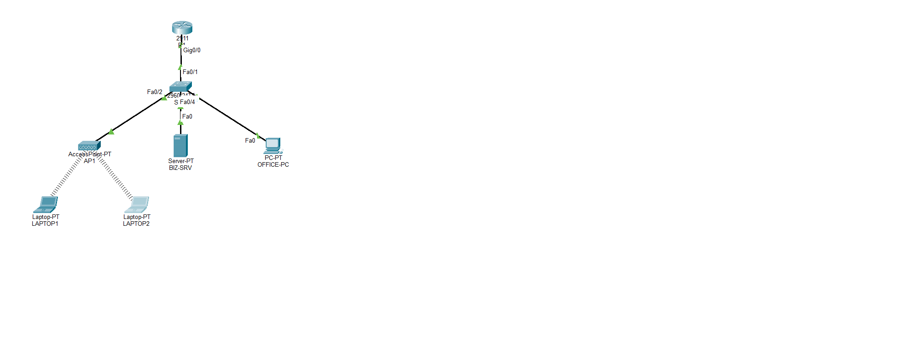
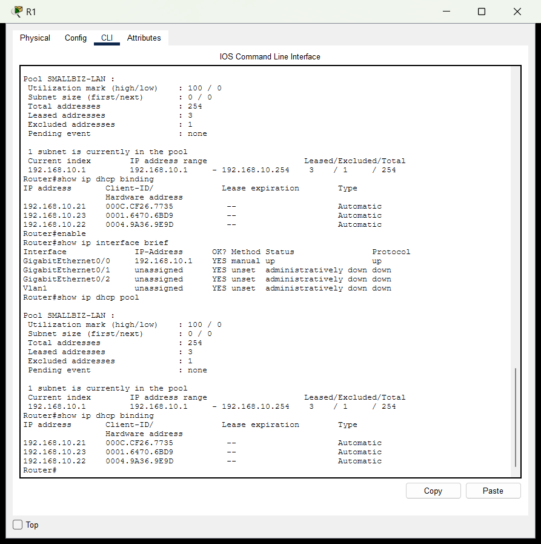
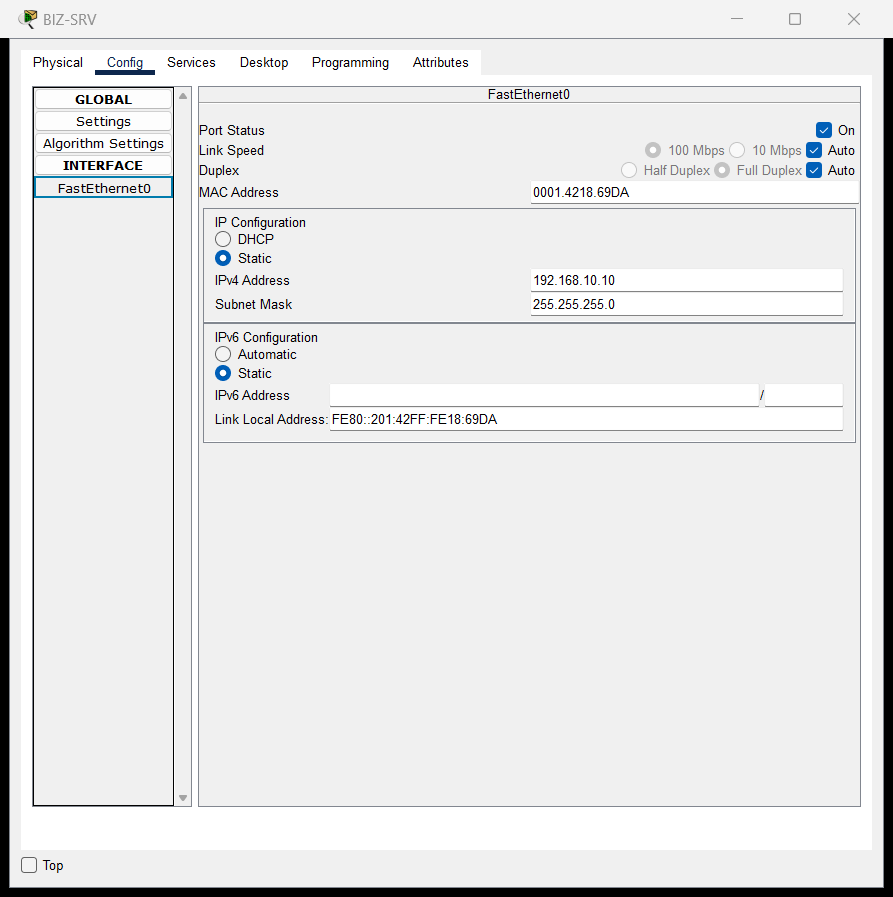
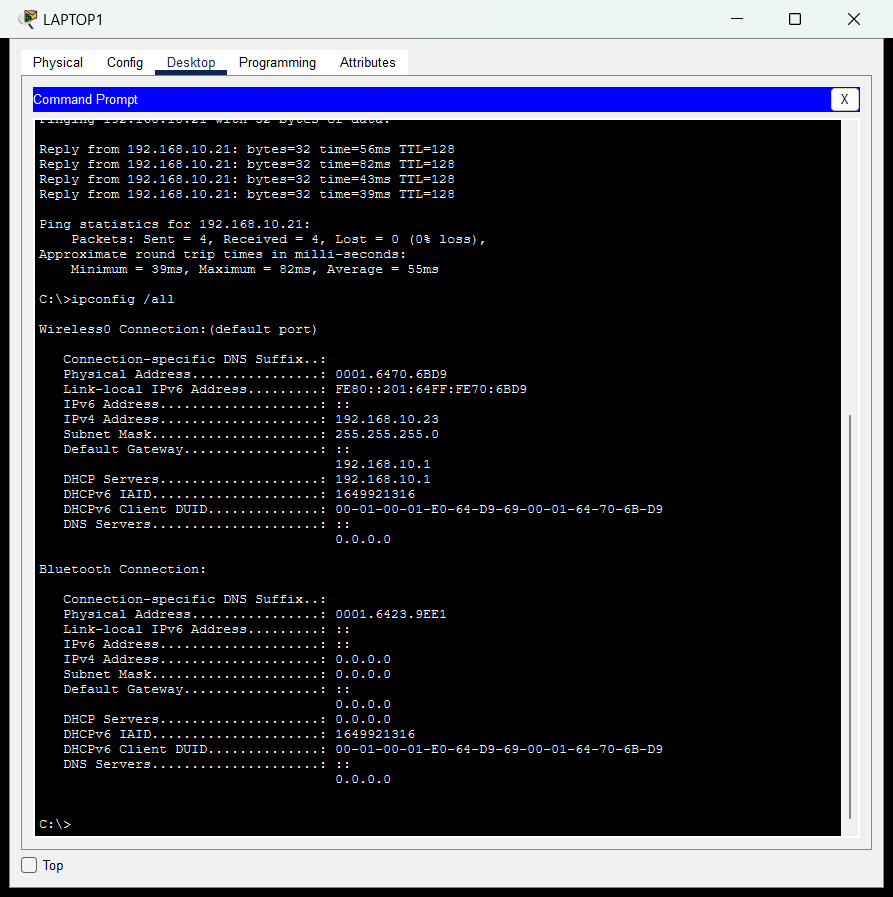
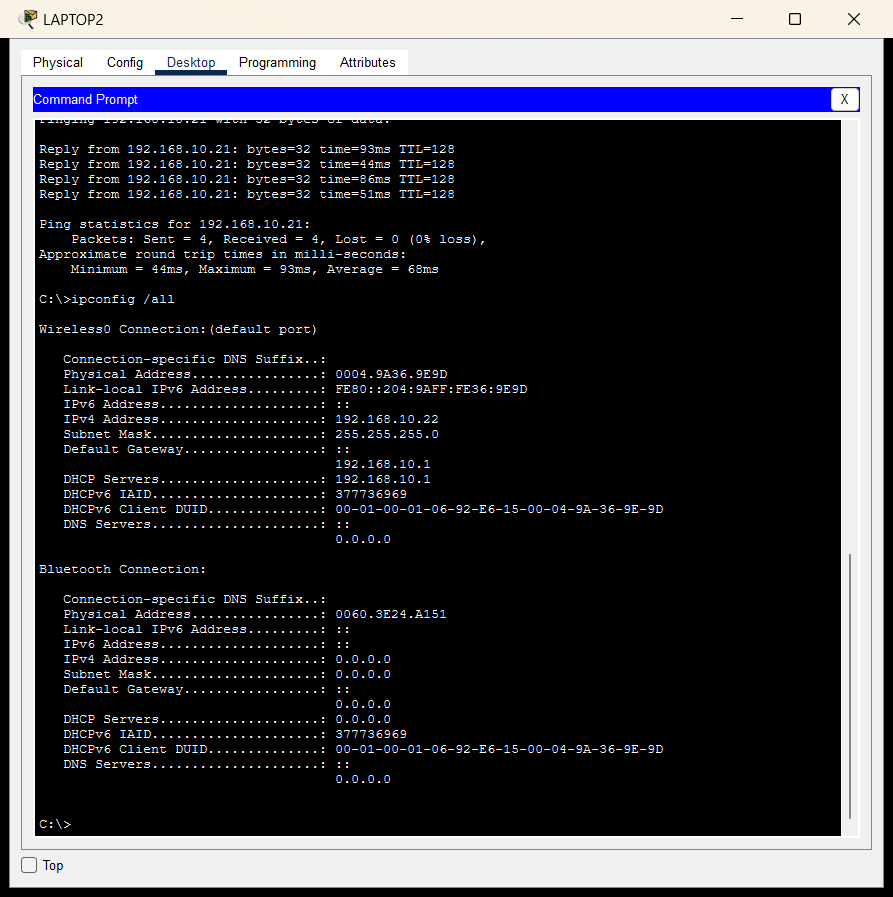
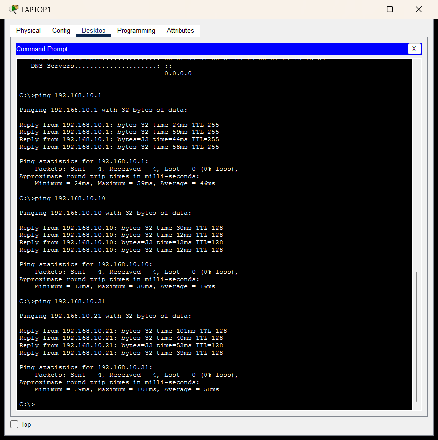
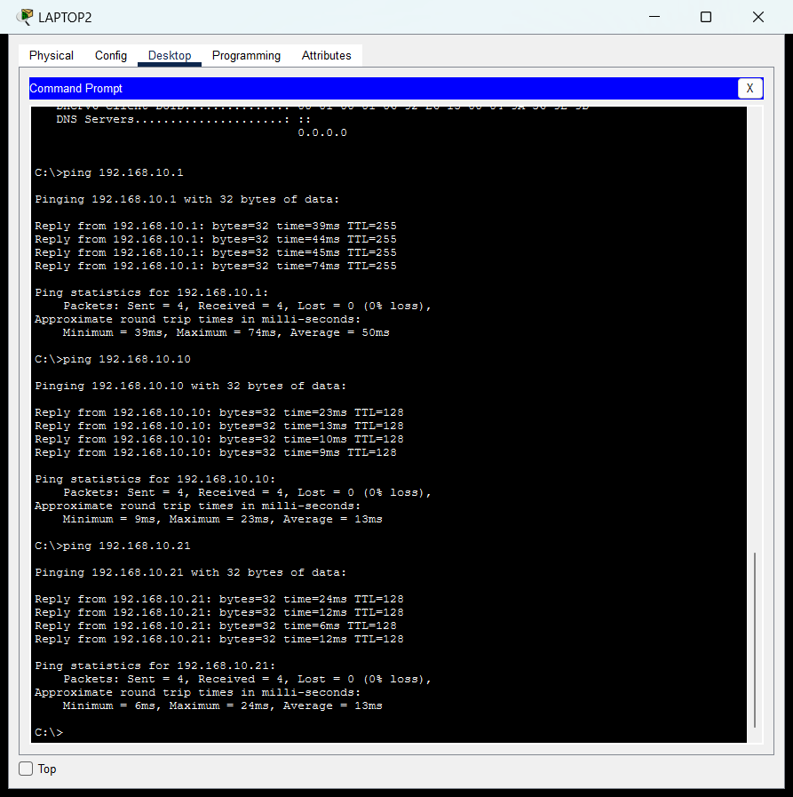
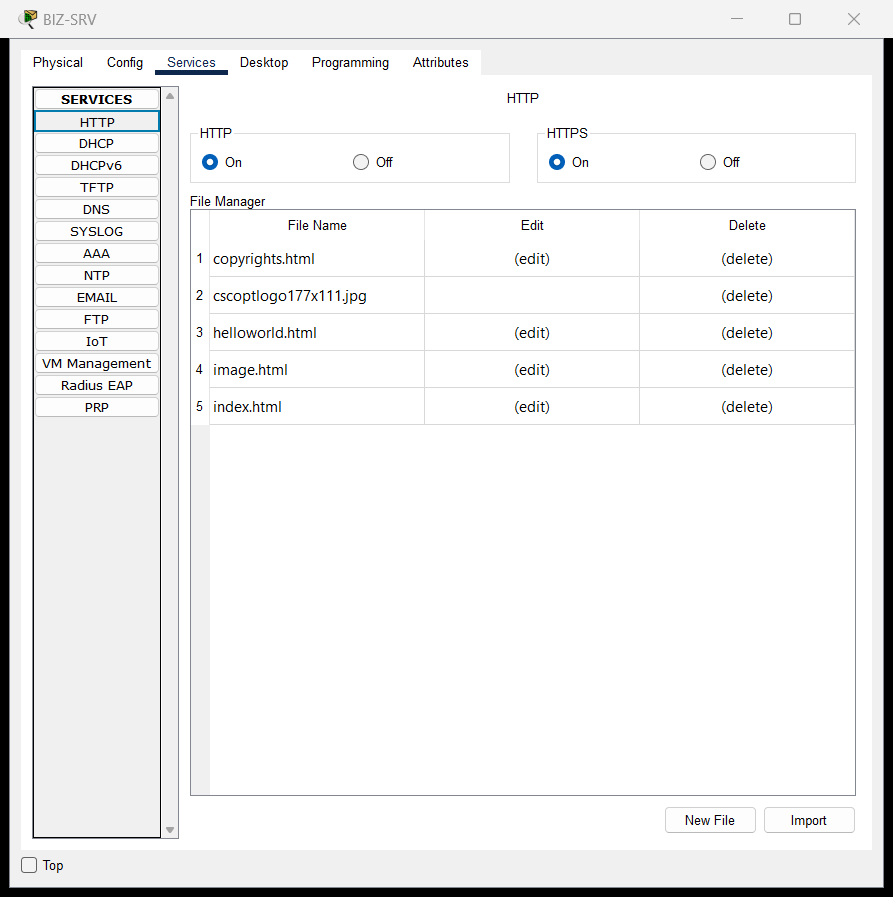
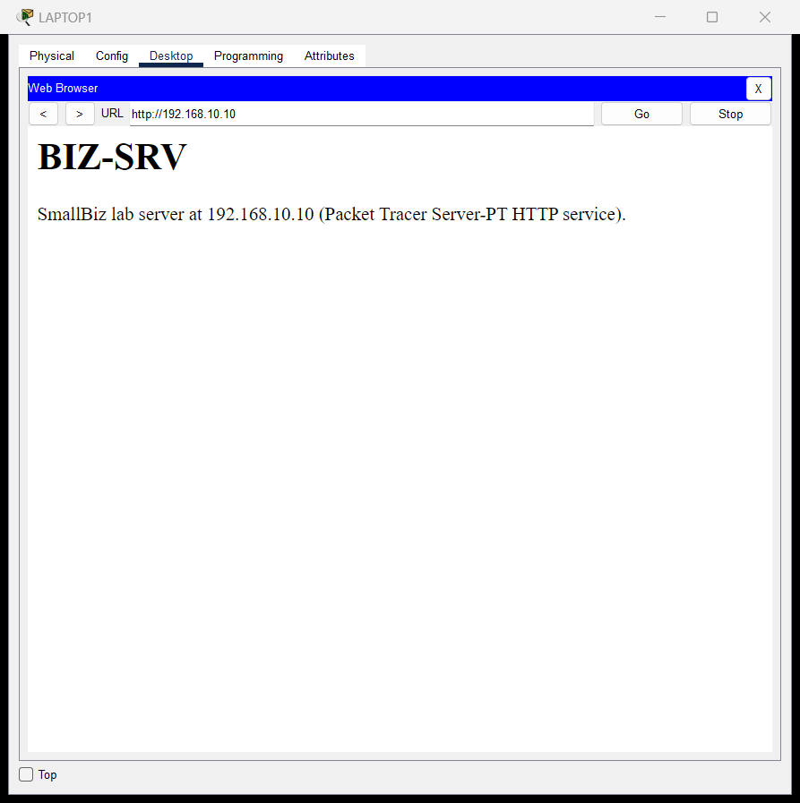

# Small Business Wireless Network (Cisco Packet Tracer)

A small-business wireless LAN built in Cisco Packet Tracer 9.0.1. One router provides the gateway and DHCP, one access point provides a WPA2-Personal (AES) network, and wired and wireless clients share a single 192.168.10.0/24 subnet.

All results below come from the live `04-Wireless-Network.pkt` project during testing. Items that were not proven are marked as such. The nine screenshots were checked locally for file presence, non-zero size, and visible content. No passphrase is shown. The `wl-06a` HTTP screenshot shows the expected page, but may show a previously loaded or cached page.

---

## Project Overview

The lab shows how a small office can combine wired devices and wireless laptops on one secured LAN with automatic addressing.

### Objectives

- Build a router, switch, access point, server and clients topology
- Provide DHCP from the router for all clients
- Broadcast one SSID, `SmallBiz-Staff`, secured with WPA2-Personal (PSK) and AES
- Verify wireless clients get addresses and can reach the gateway, a wired server and a wired PC
- Serve a custom web page from a server using Packet Tracer's Server-PT HTTP service

---

## Technologies Used

- Cisco Packet Tracer 9.0.1
- Cisco 2911 router, 2960-24TT switch, AccessPoint-PT, Server-PT, PC-PT and Laptop-PT
- Linksys-WPC300N wireless adapters (installed on both laptops)
- IOS DHCP pool and excluded-address range
- WPA2-PSK with AES on the access point
- Server-PT HTTP service (Packet Tracer's own web server; not Microsoft IIS)

---

## Network Topology

| Device | Model | Role |
|---|---|---|
| R1 | 2911 | Gateway and DHCP server |
| SW1 | 2960-24TT | LAN switch |
| AP1 | AccessPoint-PT | Wireless access point, SSID `SmallBiz-Staff` |
| BIZ-SRV | Server-PT | Wired server, HTTP service |
| OFFICE-PC | PC-PT | Wired desktop client |
| LAPTOP1, LAPTOP2 | Laptop-PT | Wireless clients (Linksys-WPC300N) |

Wired links (all straight-through):

- R1 Gi0/0 to SW1 Fa0/1
- AP1 Port 0 to SW1 Fa0/2
- BIZ-SRV Fa0 to SW1 Fa0/3
- OFFICE-PC Fa0 to SW1 Fa0/4

The laptops connect to AP1 wirelessly. The project reports 8 devices (including Packet Tracer's automatic Power Distribution Device) and 7 links (including the wireless associations).

---

## IP and DHCP Plan

| Item | Value |
|---|---|
| LAN | 192.168.10.0/24 |
| Gateway | R1 Gi0/0 = 192.168.10.1 |
| BIZ-SRV | 192.168.10.10 (static), gateway 192.168.10.1 |
| DHCP pool | `SMALLBIZ-LAN`, network 192.168.10.0/24, default router 192.168.10.1 |
| Excluded addresses | 192.168.10.1 to 192.168.10.20 |
| DNS | Not configured |

Leases at capture time (addresses can change, and Packet Tracer sometimes keeps old ones):

| Client | Address | MAC |
|---|---|---|
| OFFICE-PC | 192.168.10.21 | 000C.CF26.7735 |
| LAPTOP2 | 192.168.10.22 | 0004.9A36.9E9D |
| LAPTOP1 | 192.168.10.23 | 0001.6470.6BD9 |

R1 Gi0/1, Gi0/2 and Vlan1 are administratively down and unused. Each address shown by R1's bindings matched the client's reported address and MAC.

---

## SSID and Wireless Security

- SSID: `SmallBiz-Staff`, broadcast enabled, MAC filtering off.
- Security: WPA2-Personal (PSK) with AES, set in the Packet Tracer GUI on AP1. The MCP read of AP1 reports authentication type 4 and encryption type 4, which is consistent with WPA2-PSK/AES. The tool returns only numbers and does not decode them.
- Each laptop's Wireless0 profile uses the same SSID, WPA2-PSK, AES and the shared passphrase, entered by hand in the GUI. DHCP stays enabled.
- The passphrase is deliberately not recorded in this README, screenshots or any file. It was changed once during testing.

Notes on how the wireless side behaved:

- Before security was set, AP1 used the default SSID `Default` with open authentication, and the laptops associated on their own.
- At one point both laptops held self-assigned 169.254.x.x addresses, meaning DHCP got no answer. They returned to 192.168.10.x after the profile was corrected in the GUI.

---

## Verification Results

Pings from the final evidence runs (4 packets each, 0% loss):

| From | To | Result | Round-trip (min / max / avg) |
|---|---|---|---|
| LAPTOP1 | 192.168.10.1 | 4/4 | 24 / 59 / 46 ms |
| LAPTOP1 | 192.168.10.10 | 4/4 | 12 / 30 / 16 ms |
| LAPTOP1 | 192.168.10.21 | 4/4 | 39 / 101 / 58 ms |
| LAPTOP2 | 192.168.10.1 | 4/4 | 39 / 74 / 50 ms |
| LAPTOP2 | 192.168.10.10 | 4/4 | 9 / 23 / 13 ms |
| LAPTOP2 | 192.168.10.21 | 4/4 | 6 / 24 / 13 ms |

Earlier ping runs, including one after the passphrase update, also returned 4/4 for the same targets.

HTTP (BIZ-SRV page, 125 bytes: "BIZ-SRV / SmallBiz lab server at 192.168.10.10 (Packet Tracer Server-PT HTTP service)."):

- LAPTOP1, LAPTOP2 and OFFICE-PC each received the expected page.
- Later fetches carried the tool's note that the page was identical to the last one loaded in that browser.
- The final LAPTOP1 fetch used for the screenshot returned no content and a warning that the browser "still shows the page it had before". The tool can't distinguish "no new page" from "identical page", so **that screenshot may show a previously loaded or cached page** and is not proof of a fresh load.

| Test | Status |
|---|---|
| Laptops obtain 192.168.10.x leases | Pass |
| Laptops reach gateway, BIZ-SRV and OFFICE-PC | Pass |
| BIZ-SRV page served | Pass (see caching caveat) |
| WPA2 wrong-passphrase test | **Inconclusive, not verified** |

The wrong-passphrase test on LAPTOP2 did not prove WPA2 enforcement: the laptop still showed a valid 192.168.10.22 lease afterwards, which may have been stale. After the passphrase was replaced, the laptops kept their addresses, so a fresh re-association with the new passphrase was also not proven.

---

## Limitations

- WPA2 enforcement is not proven. The passphrase and laptop profiles cannot be read or set through the MCP, so they were set by hand.
- The MCP reports security as numbers only (authentication 4, encryption 4); the WPA2-PSK/AES reading is an interpretation.
- One HTTP screenshot may show a cached page, as described above.
- DHCP only: there is no DNS, NAT or Internet access in this lab.
- One AP and one SSID. No guest network, WPA2-Enterprise or RADIUS.
- Packet Tracer quirks seen: the pool summary shows "Excluded addresses: 1" for a 20-address exclusion; a PC command prompt hung several times; a client's address can look stale after association changes.
- The switch, AP and router have no management IP, and R1 keeps its default IOS hostname.

---

## Project Evidence

All nine screenshots below were checked locally for file presence, non-zero size, and visible content. None shows a passphrase. `wl-06a-laptop1-http.png` may show a previously loaded or cached page.

`wl-01-topology.png`, `wl-02-r1-dhcp.png`, `wl-03-biz-srv.png`, `wl-03b-biz-srv-http-service.png`, `wl-04a-laptop1-address.png`, `wl-04b-laptop2-address.png`, `wl-05a-laptop1-connectivity.png`, `wl-05b-laptop2-connectivity.png`, `wl-06a-laptop1-http.png`

Not captured: a LAPTOP2 HTTP screenshot (`wl-06b`).

---

## Project Files

- `04-Wireless-Network.pkt` is the Packet Tracer 9.0.1 project. Open it in Packet Tracer 9.0.1 or later.

---

## Skills Demonstrated

- Planning a small LAN with static and DHCP addressing
- Configuring a router DHCP pool with an excluded range
- Setting up a WPA2-PSK/AES wireless network and wireless client profiles
- Installing wireless adapters in Laptop-PT devices
- Testing with ping and HTTP, and recording unproven results honestly

## Conclusion

The wireless LAN delivers DHCP and working connectivity to two laptops and a wired PC, and serves a web page from a wired server. The WPA2 negative test and the final HTTP screenshot are inconclusive, and are marked so above.
