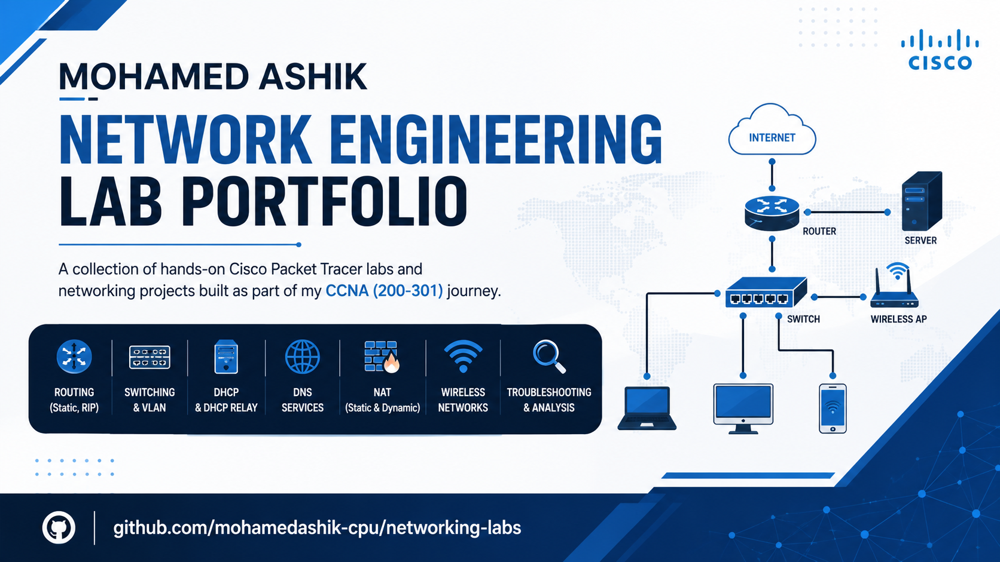

<p align="center">
  
</p>

<p align="center">
  <a href="https://github.com/mohamedashik-cpu/networking-labs">
    
  </a>
  
  
</p>

<h1 align="center">🌐 Network Engineering Lab Portfolio</h1>

<p align="center">
  <strong>Learn by building. Understand by testing. Improve by documenting.</strong><br>
  A practical collection of Cisco Packet Tracer labs, network diagrams, configurations, verification results, and project documentation.
</p>

<p align="center">
  <a href="#-about-this-repository">About</a> •
  <a href="#-lab-roadmap">Lab Roadmap</a> •
  <a href="#-featured-projects">Projects</a> •
  <a href="#-technical-coverage">Technical Coverage</a> •
  <a href="#-connect">Connect</a>
</p>

---

## 👨‍💻 About Me

Hi, I'm **Mohamed Ashik**, an aspiring **Network Engineer** from Chennai, India.

I build practical networking labs to strengthen my understanding of enterprise networking, Cisco IOS configuration, routing, switching, IP services, and troubleshooting. This repository documents my hands-on learning journey through Cisco Packet Tracer, with topology diagrams, configuration steps, verification evidence, and project files.

My long-term career direction is **Cloud Network Engineering** — building on a strong foundation in routing, switching, IP connectivity, and network operations while progressively learning cloud networking technologies.

- 🎯 **Current focus:** Enterprise networking fundamentals and practical network engineering
- 📘 **Learning path:** CCNA 200-301 concepts and hands-on implementation
- 🧪 **Lab environment:** Cisco Packet Tracer
- 🧭 **Career direction:** Network Engineer → Cloud Network Engineer

> **Note:** This repository demonstrates practical learning and lab work. It does not represent a passed CCNA certification.

---

## 📌 About This Repository

This is my practical networking portfolio. Each lab is organized to make the objective, topology, configuration, and verification process easy to follow.

| What you'll find | What it demonstrates |
|---|---|
| 🗺️ Network topologies | Designing and understanding network layouts |
| ⚙️ Configuration notes | Applying Cisco IOS commands and network services |
| 🧪 Verification evidence | Checking interfaces, routes, services, and connectivity |
| 🖼️ Screenshots | Documenting configurations and test results |
| 📁 Packet Tracer files | Reopening and exploring the practical lab scenarios |
| 📖 Lab READMEs | Recording objectives, steps, results, and learning outcomes |

---

## 🧭 Lab Roadmap

Explore the repository by topic. Each section links to its own README and individual lab folders.

| # | Learning Module | Main Topics | Explore |
|---:|---|---|---|
| 01 | **Network Fundamentals** | Connectivity, IPv4 addressing, subnetting, ping, traceroute, Cisco IOS basics | [Open module](./01-Network-Fundamentals/) |
| 02 | **Switching** | Switch configuration, VLANs, 802.1Q trunking, inter-VLAN routing, STP, EtherChannel | [Open module](./02-Switching/) |
| 03 | **Routing** | Static/default routing, RIP v1/v2, OSPF, EIGRP, route redistribution | [Open module](./03-Routing/) |
| 04 | **IP Services** | DHCP, DHCP Relay, DNS, NAT, PAT, HTTP, FTP, SMTP, POP3 | [Open module](./04-IP-Services/) |
| 05 | **Wireless** | Wireless networking labs and related documentation | [Open module](./05-Wireless/) |
| 06 | **Network Security** | Standard/extended ACLs, port security, SSH, device hardening, firewall fundamentals | [Open module](./06-Network-Security/) |
| 07 | **Troubleshooting** | Fault isolation, interface checks, connectivity recovery, verification | [Open module](./07-Troubleshooting/) |
| 08 | **Final Projects** | Integrated network designs and multi-technology implementations | [Open projects](./08-Final-Projects/) |

### Learning progress

The progress below reflects the documentation currently available in the repository. For the exact status and test coverage of a specific lab, refer to that lab's README.

| Area | Current documented progress |
|---|---|
| Network Fundamentals | 5 labs documented as completed |
| Switching | 7 labs documented as completed |
| Routing | 8 labs documented as completed |
| IP Services | 8 labs documented as completed |
| Wireless | See the module folder for current lab details |
| Network Security | 7 labs documented as completed |
| Troubleshooting | 1 lab documented as completed |
| Final Projects | Small Business Network and Enterprise Switching project documentation |

---

## 🚀 Featured Projects

These projects bring multiple networking concepts together in larger Packet Tracer scenarios.

### 1. Small Business Network

A segmented small-business network using VLANs, router-on-a-stick, DHCP, static server addressing, ISP routing, NAT/PAT, and an extended ACL.

**Key implementation areas**
- Admin, Staff, Guest, and Server VLAN segmentation
- 802.1Q trunking and inter-VLAN routing
- DHCP for end-user networks
- ISP connectivity and return routing
- NAT/PAT translation
- Guest network restrictions using an extended ACL
- Connectivity and configuration verification

[📂 View project documentation](./08-Final-Projects/01-Small-Business-Network/)

### 2. Enterprise Switching Network

A multi-layer campus switching design with redundant Layer 3 core switches, access switches, VLANs, LACP EtherChannel, Rapid PVST+, HSRP, DHCP, and routed edge connectivity.

**Key implementation areas**
- Core and access layer topology
- VLANs and 802.1Q trunking
- LACP EtherChannel between core switches
- STP root and backup-root configuration
- HSRP gateway redundancy
- DHCP and routed uplinks
- Configuration evidence and clearly identified untested scenarios

[📂 View project documentation](./08-Final-Projects/02-Enterprise-Switching/)

> Project READMEs distinguish verified configuration evidence from tests that have not yet been performed. Please refer to each project document for its exact validation status.

---

## 🧰 Technical Coverage

### Networking fundamentals
- OSI and TCP/IP concepts
- IPv4 addressing and subnetting
- Network, host, and broadcast addresses
- LAN connectivity and default gateways
- Ping and traceroute

### Switching
- Cisco switch initial configuration
- VLAN creation and access-port assignment
- 802.1Q trunking
- Inter-VLAN routing
- Router-on-a-stick
- Spanning Tree Protocol (STP)
- LACP EtherChannel

### Routing
- Static and default routes
- RIP Version 1 and Version 2
- OSPF single-area and multi-area concepts
- EIGRP
- Route redistribution
- Routing-table and neighbor verification

### IP services
- DHCP and DHCP Relay
- DNS name resolution
- Static NAT and PAT
- HTTP, FTP, SMTP, and POP3 services
- Client-server connectivity testing

### Network security fundamentals
- Standard and extended ACLs
- Switch port security
- SSH remote access
- Basic device hardening
- Cisco ASA firewall fundamentals in a simulated lab

### Troubleshooting
- Interface and link-state checks
- VLAN and trunk verification
- Routing-table inspection
- DHCP and DNS checks
- NAT translation verification
- Structured fault isolation and connectivity testing

---

## 🛠️ Tools & Technologies

<p align="left">
  
  
  
  
  
  
</p>

**Primary lab platform:** Cisco Packet Tracer.  
**Additional tools:** GNS3, Git, GitHub, and Visual Studio Code.

---

## 📂 Repository Structure

```text
networking-labs/
│
├── Assets/
│   └── banner.png
│
├── 01-Network-Fundamentals/
├── 02-Switching/
├── 03-Routing/
├── 04-IP-Services/
├── 05-Wireless/
├── 06-Network-Security/
├── 07-Troubleshooting/
│
├── 08-Final-Projects/
│   ├── 01-Small-Business-Network/
│   └── 02-Enterprise-Switching/
│
└── README.md
```

Individual lab folders may contain:
- `.pkt` Packet Tracer project files
- Network topology diagrams
- Configuration and verification screenshots
- Lab-specific `README.md` documentation

---

## 🔍 My Lab Workflow

I follow a repeatable process to make each lab easier to understand and troubleshoot:

```text
Plan the topology
      ↓
Build the network in Packet Tracer
      ↓
Configure devices and services
      ↓
Verify interfaces, VLANs and routes
      ↓
Test end-to-end connectivity
      ↓
Capture screenshots and evidence
      ↓
Document the result and lessons learned
```

---

## 🗺️ What's Next

I am continuing to strengthen my networking foundation and expand this portfolio with more practical scenarios.

- Improve and extend multi-layer switching projects
- Build more integrated routing and IP services scenarios
- Continue documenting troubleshooting cases
- Progress toward cloud networking concepts and hands-on labs
- Keep project documentation accurate, reproducible, and easy to review

---

## 🤝 Connect

<p align="center">
  <a href="https://www.linkedin.com/in/mohamed-ashik-b5ba70257/">
    
  </a>
  <a href="https://github.com/mohamedashik-cpu">
    
  </a>
</p>

<p align="center">
  <strong>Thanks for visiting my networking lab portfolio!</strong><br>
  <em>Learn • Practice • Troubleshoot • Build</em>
</p>

<p align="center">
  ⭐ If you find these labs useful, feel free to explore the folders and follow the repository.
</p>
